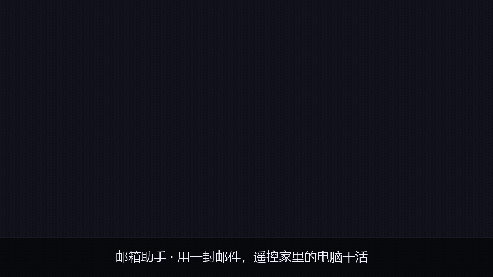

# dsh-mail-bridge

**Email as a command channel for DSH.** Send an email from your phone; the AI on your home
machine does the work and replies. Works behind NAT — no public IP, no port forwarding,
no tunnel service, no cloud account.

[中文说明](#中文说明) · [Lessons learned](docs/LESSONS.md) · [MIT License](LICENSE)

---

## Why email

The hard part of "control my home computer from outside" is not the AI — it's **reaching a
machine that has no public IP** (typical home broadband is behind carrier-grade NAT).

| Approach | Needs public IP | Needs installing | Phone client |
|---|---|---|---|
| **Email relay (this project)** | no | no — plain Node | built-in mail app |
| Port forwarding | **yes** | — | — |
| frp / Tailscale / ngrok | no, but needs a relay host | yes, both ends | yes |
| Cloud function + webhook | no | cloud account | custom script |

Email wins because it is **old, boring, and universally supported**. Your machine polls its
own inbox — an outbound connection only — so nothing needs to be reachable from outside.
And you don't have to trust a third-party relay service with your traffic.

---

## How it works



<sub>59-second overview, 1280x720, no audio, subtitles burned in.
Prefer a video file? [`docs/media/demo.mp4`](docs/media/demo.mp4).
Regenerate both with `powershell -NoProfile -ExecutionPolicy Bypass -File scripts/make-video.ps1`.</sub>

```
   your phone                        your machine (behind NAT)
 ┌──────────────┐                  ┌───────────────────────────┐
 │  Mail app    │                  │   dsh-mail-bridge         │
 │              │ ── email ──┐     │        │                  │
 │              │            │     │        ▼                  │
 │              │ ◄─ reply ──┤     │   dsh --profile headless  │
 └──────────────┘            │     │        │                  │
                             ▼     │        ▼                  │
                   ┌─────────────┴─┐│   AI does the work        │
                   │ Mail server   ││                           │
                   │ IMAP / SMTP   ││                           │
                   └───────────────┘└───────────────────────────┘
                        ▲  poll INBOX (outbound)
                        └─ send reply (outbound)
```

1. You send an email to your own address.
2. Your machine polls its inbox over IMAP.
3. The body is cleaned (quoted replies and signatures stripped) and handed to DSH.
4. DSH's answer is mailed back to you over SMTP.

---

## Features

- **Pure Node, three dependencies** — `imapflow`, `mailparser`, `nodemailer`. Nothing else.
- **Multi-provider** — works with any IMAP/SMTP provider; QQ Mail is preconfigured as an example.
- **Conversation continuity** — reuses a DSH session id so you can say "now change that script".
- **Loop-proof** — replies carry a marker header so they are never mistaken for new commands.
- **Anti-spoofing** — sender allowlist + SPF/DKIM verification + optional shared secret.
- **Quote stripping** — recognizes the reply-quoting formats of Gmail, Outlook, QQ/NetEase, etc.
- **Signature stripping** — recognizes auto-appended signatures, so `new session` still works
  even when your mail app adds two extra lines.
- **Permission self-healing** — detects when DSH refused an operation for permissions and
  automatically retries in a fresh session (see below).
- **Crash-resistant** — `unhandledRejection` / `uncaughtException` are caught and logged; one
  bad email cannot take down the batch or the process.
- **Log rotation** — caps the log file at 2 MB.

---

## Requirements

- **Node.js >= 18**
- **A mailbox with IMAP/SMTP enabled.** Get an **app-specific authorization code** — not
  your account password. For QQ Mail: *Settings → Account → enable IMAP/SMTP service*.
- **DSH (DeepSeek Harness).** This project contains no AI of its own — it is a bridge that
  hands your email off to DSH. Install it with:

  ```bash
  npm install -g @deepseek-ai/dsh
  dsh --version        # should print a version
  ```

  That gives you a `dsh` command on your PATH, which is what this bridge looks for.
  (`npm run doctor` reports whether it found it.)

---

## Quick start

```bash
git clone https://github.com/QIKO0721/dsh-mail-bridge.git
cd dsh-mail-bridge
npm install

npm run init       # writes config.json, tells you exactly what to fill in
#   → open config.json and set three fields:
#        email      your mailbox address
#        authCode   the app-specific authorization code (NOT your login password)
#        allowFrom  the ONLY addresses allowed to command your machine

npm run doctor     # environment check; does NOT connect to mail or run tasks
npm start          # start polling
```

**Language.** The CLI, the reply emails and the log lines all follow your system
locale (Chinese locale → Chinese, anything else → English). Override it when you
want something else:

```bash
node bin/cli.js --lang=en doctor     # force English for this run
export MAIL_BRIDGE_LANG=zh           # or set it for the whole shell
```

`doctor` is the step worth reading carefully — it checks Node, dependencies, your config,
whether it can find DSH, and whether your permission config is monitorable, and it tells you
how to fix each thing it complains about.

Then send an email to yourself:

```
To:      your-address@example.com
Subject: anything
Body:    how much disk space is left on D:?
```

You'll get a reply within a poll interval plus processing time.

### Turning it into a real service

`npm start` occupies the terminal it runs in. To keep it running:

- **Windows** — put a shortcut to `npm start` (or a `.cmd` that runs it) in
  `shell:startup`, or register it as a scheduled task set to run at logon.
- **Linux/macOS** — write a systemd unit or a launchd plist, or use `pm2` / `tmux` / `screen`.

As long as it keeps running, it keeps polling. If the machine sleeps or loses network, the
polling simply fails and retries — check the log if replies stop arriving.

### Special commands

Put **only** one of these in the body:

| Body | Effect |
|---|---|
| `help` | replies with usage instructions |
| `new session` / `new` / `reset` | clears memory; the **next** email starts fresh |

> The reset takes effect on the **next** email, not the one carrying the command — that reply
> is sent without invoking DSH.

---

## Configuration

`config.json` is created by `npm run init` and is **gitignored** (it holds your auth code).

```jsonc
{
  "email": "you@example.com",
  "authCode": "your-16-char-app-code",
  "allowFrom": ["you@example.com"],      // the ONLY addresses allowed to command this machine

  "imap": { "host": "imap.qq.com", "port": 993, "secure": true },
  "smtp": { "host": "smtp.qq.com", "port": 465, "secure": true },

  "pollSeconds": 15,                     // how often to check the inbox (min 5)
  "taskTimeoutSeconds": 600,             // kill a task that runs longer than this
  "maxTaskChars": 8000,                  // truncate very long bodies before handing them off
  "maxReplyChars": 40000,                // cap on the reply body
  "maxPerPoll": 10,                      // most unread messages handled per poll cycle

  "dshBin": "",                          // empty = auto-detect
  "dshProfile": "headless",
  "sessionId": "",                       // empty = each email is independent

  "fromName": "Mail Bridge",             // display name on replies, also the signature tag

  "secret": "",                          // optional passphrase required in the body
  "strictAuthCheck": true,               // set false only if your own SPF setup fails
  "stripSignatures": true                // strip auto-appended signature blocks
}
```

### Fields worth explaining

| Field | Why you might change it |
|---|---|
| `sessionId` | Leave empty for one-shot commands. Set it (or just let it fill in) to keep context across emails. |
| `fromName` | Shown as the sender name on replies. Also used as the tag at the end of each reply. |
| `stripSignatures` | On by default. Many mail apps append a "name + address" block; stripping it keeps that noise out of the task text and stops it from breaking special commands. Turn it off if you *want* those lines passed through. |
| `strictAuthCheck` | Requires SPF to pass on externally-delivered mail. Turn it off only if you send from a self-hosted server that legitimately fails SPF. |
| `taskTimeoutSeconds` | How long one task may run before its DSH subprocess is killed. |
| `maxTaskChars` | Bodies longer than this are truncated with a note. Raise it if you send long prompts. |
| `maxPerPoll` | How many unread messages one poll cycle will handle. This is a **backpressure** control: without it, a backlog of unread mail is consumed serially, and since one task can take a minute, a few hundred unread messages would stall polling for hours while you assume it is working. The rest are picked up on the next cycle. |

---

## Security

This program **lets an email command a computer**. Read this part.

| | |
|---|---|
| **The auth code is a password.** | Anyone who has it can read and send your mail. Never commit it, never screenshot it. |
| **Tighten `allowFrom`.** | It is the primary gate. Keep it to your own addresses. |
| **Sender addresses can be forged.** | That is why the allowlist alone is not enough — see below. |
| **The AI can execute commands.** | It can read/write files and run programs. That is the point, and the risk. |

### Anti-spoofing: why `From` alone is not enough

Measured behavior (QQ Mail; other major providers are similar):

| Message origin | `Authentication-Results` header |
|---|---|
| Sent from inside the provider (web / official app / its own SMTP) | absent |
| Delivered from an external server | present — contains `spf=` / `dkim=` results |

So the rule is:

```
no Authentication-Results  →  internal delivery  →  allow
has Authentication-Results →  external          →  require spf=pass
                                                   spf=fail → block and log
```

A forger is not in the provider's SPF-authorized list, so their message is tagged `spf=fail`
and dropped. Blocked messages are logged:

```
[time] !! blocked suspicious mail (UID 123): SPF did not pass (sender may be forged)
       claimed-from=someone@example.com  [mx.example.com; spf=fail(1.2.3.4) ...]
```

> **Read this caveat.** The rule above rests on one assumption: *your provider only omits
> `Authentication-Results` for mail sent from inside its own system.* That was measured on
> QQ Mail, and it holds for the major providers — but it is a **provider behaviour, not a
> protocol guarantee**. If you use a provider that omits the header for external mail too,
> then "no header → allow" becomes "skip the check", and the allowlist is your only defense.
>
> **If you want that assumption not to matter, set `secret`.** With a passphrase, a message
> without it is dropped regardless of what the headers say. That is the difference between
> "this provider was measured to behave correctly" and "this cannot work without the
> passphrase". For a program that lets an email run commands on your machine, the second
> property is worth the small inconvenience.

---

## Permission self-healing

DSH reads its permission preset **when a session is created**, and changing the config never
affects existing sessions. Because this bridge reuses one session id to keep context, a
"changed the permissions and restarted" workflow appears to do nothing at all.

Two defenses:

1. **Permission fingerprint.** At startup, a hash of the DSH permission config files is
   compared against the last one. If it changed, the session id is cleared so the next email
   creates a fresh session that picks up the new preset.
2. **Denial detection.** If a tool result in the DSH event stream contains an OS-level access
   denial (`ERROR_ACCESS_DENIED`, `EACCES`, …), the bridge drops the session, retries the task
   once in a fresh session, and says so in the reply — because silently losing context would be
   worse than the denial itself.

It retries **once**, never in a loop. If the fresh session is denied too, the problem is the
configuration, and the reply says exactly that. Detection deliberately requires both a
denial phrase *and* an error code, because a false positive would wipe your conversation for
no reason.

---

## Testing

```bash
npm test                 # all suites
node tests/run-all.js permission   # filter by filename
node tests/run-all.js --list       # list without running
```

**No mailbox and no DSH installation are required.** The suite ships a mock DSH
(`tests/helpers/mock-dsh.js`) that reproduces success, permission denial, unknown session,
timeout, and empty output, plus fake IMAP/SMTP layers. Tests that touch the config or the
session state run inside a temp directory and never touch your real files.

`static-audit.test.js` additionally scans the source itself for the class of mistake unit
tests cannot see: unresolvable relative `require`s, exports that are `undefined`, leftover
`debugger`/`TODO`, stray `console.log` in `src/`, and — most importantly — anywhere the auth
code or the whole config could reach a log line.

### Pre-publish privacy scan

If you fork this and put your own details in it, check before you push:

```powershell
powershell -NoProfile -ExecutionPolicy Bypass -File scripts/privacy-scan.ps1
```

It walks **every commit in the history** looking for leftover personal data — mailbox
addresses, auth codes, local paths, usernames — and also prints the **commit authorship**,
which is where identity tends to leak without anyone noticing. Exits non-zero if anything is
found, so it can gate a release.

> Commit authorship is a real leak vector: `git config user.name` defaults to your OS
> username and gets stamped on every commit, visible on GitHub forever. Set it deliberately
> before you publish.

### Live checks (optional, need a real machine)

The suite above runs entirely on doubles, which cannot catch "our assumption about the real
interface was wrong". Two extra scripts close that gap. They are **not** part of `npm test`,
because they hit the network and spend real tokens.

```bash
# real DSH: stdin delivery, long tasks, session resumption, stale-session recovery
node tests/integration.dsh.js              # auto-skips if DSH is absent
node tests/integration.dsh.js              # DSH_INTEGRATION=require to force

# real mailbox: IMAP login, fetching, parsing, classification (read-only)
node tests/live-mail-check.js --recent

# full pipeline incl. a real DSH run and a real SMTP send
node tests/live-e2e.js <UID>
```

`live-e2e.js` never mails anything to a real person: it rewrites the delivery address to
`@example.invalid` (an RFC 2606 reserved domain that can never resolve) so it can exercise the
compose-and-send path without delivering. Note that a large relay may still *accept* such a
message and bounce it later — the bounce comes back to you, and reaches nobody else.

---

## Limitations

- **One task at a time.** A task that runs to timeout blocks the queue.
- **Mail is marked read before processing.** A failed task is not retried automatically — you
  get an error reply, so just send it again.
- **`pollSeconds` lower bound is 5s.** Polling too aggressively gets you rate-limited.
- **Long bodies are truncated** at `maxTaskChars` (default 8000). The task is delivered on
  stdin, so the OS command-line limit is not the constraint here — this is a deliberate cap.
- **Session permission is fixed at creation.** See *Permission self-healing* above.

---

## Lessons learned

Building this surfaced several failure modes that are easy to get wrong and hard to notice.
They are written up in [docs/LESSONS.md](docs/LESSONS.md), including:

- a mail app's automatic signature silently breaking command detection;
- a permission fingerprint that changed because the program wrote its own state file;
- an error message that was correct but unrecognizable to the parser that had to match it.

---

## License

[MIT](LICENSE). Provided as-is; you are responsible for what you let it do.

---

## 中文说明

**用一封邮件，遥控一台没有公网 IP 的电脑上的 DSH 干活。**
不需要公网 IP、不需要端口转发、不需要内网穿透、不需要云函数。

### 原理

手机发一封邮件到自己的邮箱 → 家里的电脑通过 IMAP 主动轮询收件箱 →
把正文清洗干净后交给 DSH 执行 → 把结果通过 SMTP 回信给手机。

全程只用到**主动连出去**的连接，所以路由器后面的电脑也能用。

### 快速开始

```bash
git clone https://github.com/QIKO0721/dsh-mail-bridge.git
cd dsh-mail-bridge
npm install

npm run init      # 生成 config.json，并告诉你该填什么
#   → 填 email、authCode、allowFrom
npm run doctor    # 环境自检（不连邮箱、不跑任务）
npm start
```

`authCode` 是**邮箱授权码**，不是登录密码。以 QQ 邮箱为例：
设置 → 账户 → 开启「IMAP/SMTP 服务」→ 按提示发一条短信 → 拿到 16 位授权码。

### 特殊指令

正文**只写**下面之一：

| 正文 | 作用 |
|---|---|
| `帮助` / `help` | 回一封用法说明 |
| `新会话` / `新对话` / `new` / `reset` | 清空记忆，**下一篇**邮件当全新对话 |

> 注意：清空是**下一篇**才生效 —— 发指令的那封信是直接回你的，没有经过 DSH。

### 安全提醒

- **授权码等于密码**，泄露了别人就能收发你的邮件。别提交、别截图。
- **`allowFrom` 必须收紧到只有你自己**，那是第一道闸门。
- **光看发件人地址不够** —— 地址可以伪造，所以程序还会校验 SPF/DKIM（原理见上面英文部分）。
- **它能执行命令**：读写文件、跑程序。这是设计如此，也是风险所在。

### 权限自愈

DSH 的权限预设**只在创建会话时读一次**，改完配置对已有会话无效。
而本程序为了记住上下文会复用同一个会话 —— 于是「改完权限 → 重启 → 毫无变化」。

程序有两道防线：启动时比对权限配置指纹（变了就换会话），
以及干活时发现操作系统级拒绝就自动换新会话重跑一次（只重试一次，会如实告知）。

### 测试

```bash
npm test
```

**不需要真邮箱、不需要装 DSH** —— 测试自带假的 DSH 与假的收发信层，
并且把配置、会话状态都写在临时目录里，不碰你的真实文件。
